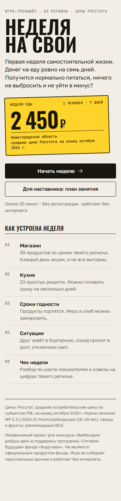
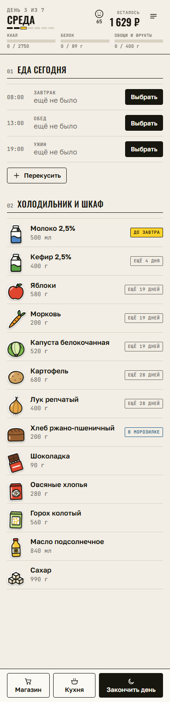
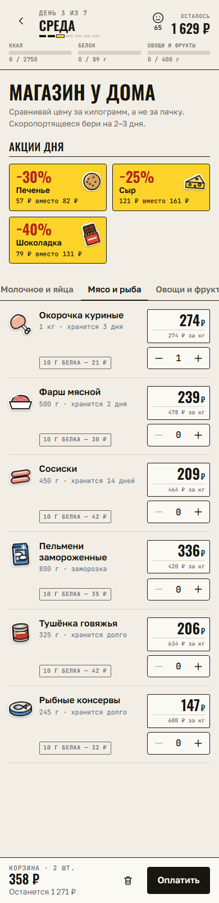
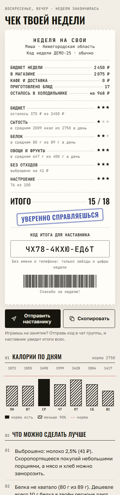
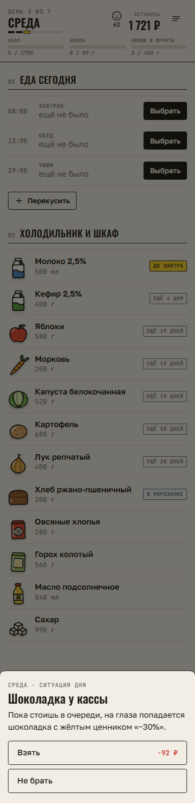
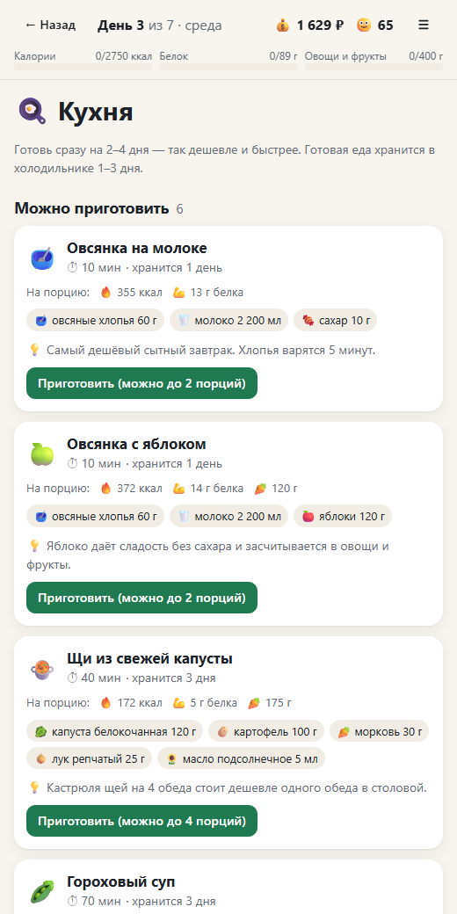
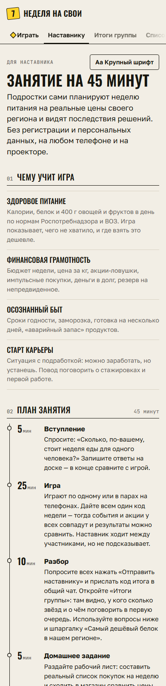
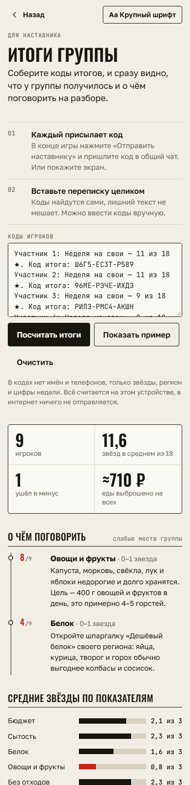

# Неделя на свои

**Игра-тренажёр для подростков из детских домов: первая неделя самостоятельной жизни.** На еду дана фиксированная сумма. Нужно закупиться, готовить, следить за сроками годности, разруливать жизненные ситуации и при этом нормально питаться. Цены настоящие: данные Росстата по 82 регионам России.

Сделано для программы **«Готовим будущее»** фонда X5 «Выручаем». Это готовый материал для наставников, которые учат воспитанников планировать расходы, выбирать продукты и готовить.

▶ **Играть: https://fle3n.github.io/nedelya-na-svoi/** · итоги недели: [пример](https://fle3n.github.io/nedelya-na-svoi/?demo=final) · итоги группы для наставника: [пример](https://fle3n.github.io/nedelya-na-svoi/?demo=group)

| Старт | День | Магазин | Итоги |
|---|---|---|---|
|  |  |  |  |

| Событие | Кухня | Для наставника | Итоги группы |
|---|---|---|---|
|  |  |  |  |

---

## Какую задачу решает

Фонд «Выручаем» вместе с «Перекрёстком» ведёт программу «Готовим будущее». По словам фонда, в учреждениях около 50 тыс. детей-сирот, больше половины из них подростки 14–17 лет, и выпускники «часто не имеют бытовых навыков и основ финансового планирования». В ноябре 2026 года программа выходит в новые регионы: Дзержинск, Красноярск, Карелию, Астрахань, Казань, Псковскую и Ленинградскую области. Только в октябре прошло 12 занятий для 58 воспитанников.

Наставникам в каждом новом регионе нужны материалы для занятий, которые:
- интересны подросткам, а не выглядят как лекция;
- привязаны к реальным ценам их города, а не к абстрактным «100 рублям»;
- работают на любом телефоне без установки и регистрации, в том числе при плохом интернете;
- дают наставнику готовый план занятия и тему для разговора.

«Неделя на свои» закрывает все четыре пункта.

## Что внутри

**Для подростка: игра на 15–20 минут**
- **Выбор героя, региона и бюджета.** Бюджет считается по ценам выбранного региона: в Нижегородской области «обычная» неделя стоит 2 450 ₽, в Москве 3 350 ₽, на Чукотке 8 300 ₽.
- **Магазин:** 39 товаров с ценами Росстата. Показаны цена за кг, срок хранения и «сколько стоят 10 г белка». Каждый день есть акции, среди них встречаются ловушки (скидка на газировку и шоколад).
- **Кухня:** 23 простых рецепта, от овсянки до плова. Калорийность и белок считаются из ингредиентов. Готовить можно на несколько дней, готовая еда тоже портится.
- **Сроки годности и заморозка:** фарш портится за 2 дня, хлеб за 4. Мясо и хлеб можно заморозить кнопкой со снежинкой. Выброшенное считается в рублях.
- **16 жизненных ситуаций:** друг зовёт в бургерную, сосед просит в долг, отключили свет, «3 йогурта по цене 2», подработка, простуда. У каждого выбора есть последствия и короткий вывод.
- **Чек недели.** Итоги оформлены как кассовый чек: сколько потрачено в магазине и в кафе, звёзды по шести показателям (бюджет, сытость, белок, овощи и фрукты, выброшенная еда, настроение) и печать с оценкой. Плюс персональные советы с цифрами по региону, например: «На кафе ушло 342 ₽ — это 1,2 кг курицы, примерно 6 порций домашней еды».

**Для наставника** (кнопка «Для наставника» на главной)
- План занятия на 45 минут и 8 вопросов для разбора.
- **Код недели.** Вся группа получает одинаковые события и акции, поэтому результаты можно честно сравнить.
- **Итоги группы.** В конце игры у каждого подростка есть код итога из 12 символов и кнопка «Отправить наставнику». Наставник вставляет переписку из чата группы целиком, коды находятся сами. Он видит средний результат, сколько человек ушло в минус, сколько еды выброшено на всех, два слабых места группы с готовыми темами для разбора и таблицу по участникам. Если группа переиграла ту же неделю, видно, насколько выросли результаты во второй попытке. Сервер не нужен. В коде нет имени и телефона: только звёзды, регион и несколько цифр недели. Код защищён от опечаток, любую ошибку в одном символе он ловит.
- Шпаргалка цен по выбранному региону: где дешевле белок, овощи и фрукты, бюджет недели.
- Материалы для печати: рабочий лист «Мой план питания на неделю», шпаргалка цен, итоги игрока.
- Крупный шрифт для проектора.

Игра покрывает все четыре направления программы: здоровое питание, финансовую грамотность, осознанный быт и старт карьеры (ситуация с подработкой).

## Польза для фонда и благополучателей

1. **Готовый масштабируемый инструмент для «Готовим будущее».** Наставник в любом из 82 регионов открывает ссылку, и через минуту группа играет на ценах своего региона. Не нужно ничего готовить, печатать заранее или устанавливать.
2. **Реальные навыки вместо абстракций.** Цена за кг, белок, сроки годности, заморозка, резерв, долги. Каждая тема видна в последствиях, а не в правилах.
3. **Измеримый результат занятия.** Экран «Итоги группы» за минуту собирает результаты всех участников и сравнивает первую и повторную попытку. Например: «первая попытка — 10 звёзд в среднем, повторная — 14,7». Распечатку можно приложить к отчёту донорам, и для этого не нужны ни анкеты, ни сбор персональных данных.
4. **Тот же движок подходит другим благополучателям.** Например, семьям с продуктовым сертификатом на 5 000 ₽ из акции «Праздник на стол»: можно сменить героя и бюджет.

## Как внедрить (за один день)

- **Хостинг.** Это статический сайт: HTML, CSS и JavaScript, ноль зависимостей, без сервера и базы данных. Подойдёт GitHub Pages, сайт фонда, любой хостинг или iframe на странице программы.
- **Без персональных данных.** Игра ничего не отправляет в сеть. Прогресс хранится только в браузере игрока, поэтому вопросов по 152-ФЗ не возникает.
- **Офлайн.** После первого открытия работает без интернета (PWA) и ставится на главный экран телефона.
- **Тексты правят без программиста.** Товары, рецепты, ситуации и материалы для наставника лежат в обычных файлах `js/data/*.js`.
- **Обновление цен раз в месяц** одной командой. Python 3 без сторонних библиотек:
  ```
  python tools/build_prices.py sred_potreb_cen_MM-YYYY.xlsx
  ```
  Файл берётся на странице Росстата «Цены»: https://rosstat.gov.ru/statistics/price → «Средние потребительские цены на отдельные товары и услуги».
- **Регионы программы** перечислены в `js/data/mentor.js`. Они показываются первыми в списке.

## Данные и источники

| Что | Источник |
|---|---|
| Цены на 39 продуктов и еду вне дома по 82 регионам | Росстат, средние потребительские цены на конец октября 2026 г. (`sred_potreb_cen_10-2026.xlsx`) |
| Нормы калорий и белка | МР 2.3.1.0253-21 Роспотребнадзора, 18–29 лет, 2-я группа активности: 2 200 ккал и 72 г белка для девушек, 2 750 ккал и 89 г для юношей |
| 400 г овощей и фруктов в день | Рекомендация ВОЗ |
| Калорийность и белок продуктов | Типовые справочные значения на 100 г |
| Описание программы «Готовим будущее» | Новости фонда «Выручаем», ноябрь 2026 |

В Росстате нет отдельной цены «лапши быстрого приготовления». Для неё взята позиция «Сухие супы в пакетах».

## Проверка качества

- **`tests/tests.html`**: 39 тестов игрового движка. Покупки, готовка, сроки, заморозка, события, долги, отчёт, код итога и сводка по группе. Отдельно проверяется, что любая опечатка в одном символе кода обнаруживается. Есть и **тест баланса**: «разумный игрок» проходит неделю во всех 82 регионах за обоих героев на двух уровнях сложности. На «Обычно» он везде получает 16–18 звёзд из 18 и не уходит в минус, на «Туго» результаты заметно ниже. Так проверяется, что игра честная в любом регионе.
- **`tests/ui.html`**: сквозной тест интерфейса. Неделя проходится кнопками от старта до итогов, включая печать, режим наставника и итоги группы с кодом этого игрока, и проверяется, что не было ни одной ошибки JavaScript.

- **`tests/layout.html`**: проверка вёрстки на 8 размерах экрана: маленький телефон 320 px, Android, iPhone, телефон боком, планшет в обеих ориентациях, ноутбук 1366×768 и ПК 1920×1080. На каждом размере игра проходит все экраны и окна, включая крупный шрифт, и проверяется, что ничего не вылезает за край, текст помещается в кнопки, а кнопки на телефоне не меньше 36 px.

Как запустить:
```
python -m http.server 8000
```
Затем откройте http://localhost:8000/tests/tests.html, http://localhost:8000/tests/ui.html и http://localhost:8000/tests/layout.html.

Демо-режим для показа: `?demo=day`, `?demo=event`, `?demo=shop`, `?demo=kitchen`, `?demo=meal`, `?demo=final`, `?demo=mentor`, `?demo=group`. В нём открывается неделя «разумного игрока», сохранение пользователя не затрагивается.

## Структура

```
index.html            — оболочка
css/style.css         — оформление «ценник и кассовый чек»: светлая и тёмная тема, печать, крупный шрифт
fonts/                — шрифты Oswald, Golos Text, JetBrains Mono (SIL OFL 1.1) и их лицензии
js/engine.js          — игровая логика без DOM
js/app.js             — экраны и кнопки
js/results.js         — код итога и сводка по группе для наставника
js/autoplay.js        — «разумный игрок» для демо и теста баланса
js/stickers.js        — стикеры продуктов и блюд (SVG)
js/data/prices.js     — цены Росстата (генерируется скриптом)
js/data/products.js   — товары, нормы, уровни сложности, акции
js/data/recipes.js    — рецепты
js/data/events.js     — жизненные ситуации
js/data/mentor.js     — материалы для наставника, регионы программы
tools/build_prices.py — обновление цен из файла Росстата (Python 3, без зависимостей)
tools/og.html         — картинка для соцсетей и иконки
tools/stickers.html   — лист всех стикеров
sw.js                 — офлайн-режим
tests/                — тесты движка, баланса и интерфейса
```

## Как сделано

Проект создан с нуля методом вайбкодинга в Claude Code в ноябре 2026 года для конкурса «Вайбкодинг добрых дел». Сторонних библиотек нет.

Оформление построено на том, что подросток видит в магазине каждый день: жёлтый ценник с ценой за килограмм, кассовый чек, наклейки «съесть сегодня». Итоги недели — это чек с печатью и кодом для наставника. Иконки интерфейса и 69 стикеров продуктов и блюд нарисованы в SVG прямо в коде (`js/stickers.js`, все стикеры на одном листе — `tools/stickers.html`). Системные эмодзи не используются, поэтому картинки выглядят одинаково на любом телефоне.

Сторонние материалы: шрифты [Oswald](https://github.com/googlefonts/OswaldFont), [Golos Text](https://github.com/googlefonts/golos-text) и [JetBrains Mono](https://github.com/JetBrains/JetBrainsMono) под свободной лицензией SIL Open Font License 1.1 (урезаны до кириллицы и латиницы, лежат в `fonts/` вместе с текстами лицензий) и открытые данные Росстата.

Независимый проект: не является официальным продуктом фонда «Выручаем» или X5.

## Лицензия

Все права защищены. Играть и смотреть код можно свободно. Права на внедрение передаются фонду и организатору конкурса по договору. Подробнее — в файле [LICENSE](LICENSE).
